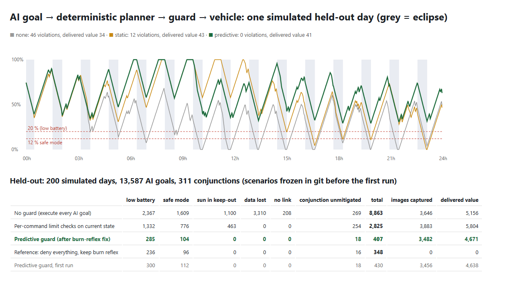

# Onboard command guard: should this AI-chosen command reach the vehicle?

> Unofficial prototype by Kushagra Pratap Singh. Not affiliated with Orca Aerospace. This is a simulation for evaluating guard logic, not flight software. The spacecraft, parameters and scenarios are invented.

[Orca Aerospace](https://orcaaerospace.com/) puts the spacecraft operator on board:
1. An AI chooses the next goal.
2. A deterministic planner turns it into commands.
3. Guardrails approve or deny every command before it reaches the vehicle.

This repo is a small, testable version of step 3. It also includes the simulator needed to show whether a guard is any good.



## What's in it
- **Geometry** ([`orcaguard/orbit.py`](orcaguard/orbit.py)), using a circular two-body orbit with Earth rotation:
  - a fixed sun for the day, set by the beta angle;
  - cylindrical eclipse;
  - ground-station passes above 10°;
  - imaging opportunities: off-nadir under 30° over a sunlit target, with the camera-to-sun angle recorded.
- **Vehicle** ([`orcaguard/sim.py`](orcaguard/sim.py)):
  - battery, with solar power that depends on where the panels point;
  - loads: bus, eclipse heater, camera, radio, slews, burns;
  - storage, with FIFO downlink and the value of delivered images;
  - slew rate and a 50° camera sun keep-out;
  - conjunctions: a burn is required inside [TCA−3 h, TCA−30 min] and needs at least 40% SoC;
  - safe mode below 12% SoC until 50%.
- **Simulated AI layer** ([`orcaguard/scenario.py`](orcaguard/scenario.py)): a greedy goal-picker with no resource model. It makes the mistakes such a picker makes:
  - it chains captures through eclipses;
  - it ignores the sun keep-out;
  - it puts a downlink one orbit off;
  - it forgets a conjunction, or burns after TCA;
  - it overfills storage.
- **Guards** ([`orcaguard/guard.py`](orcaguard/guard.py)). Each goal reaches the guard when its command would start. The guard sees current telemetry, the ephemeris and what it already approved.
  - **none:** approve everything.
  - **static:** per-command limit checks on the *current* state:
    - SoC ≥ 30%;
    - room for an image;
    - station in view;
    - commanded pointing vs the sun at the capture moment;
    - SoC ≥ 40% for a burn.
  - **predictive** (this repo's guard): roll the vehicle forward with the guard's own nominal model through the command plus one orbit. The verdicts are:
    - **DENY**, with the reason ("SoC would fall to 21% within the next orbit", "sun inside the 50° keep-out while pointing", "burn at step 545 is outside the window [159, 459]");
    - **MODIFY**: re-time a downlink to the next real pass, or trim it to the part of the pass that is safe;
    - **REFLEX**: schedule the collision-avoidance burn itself if none is approved in the window, and hold SoC for it.
- **Truth vs model:** the vehicle is simulated with parameters that differ from the guard's model (solar, loads, capacity: ±10% on dev, ±15% held-out). So the guard is never exactly right. Its SoC floor of 27% (against a 20% violation line) was set on dev.

## Results: 200 held-out simulated days (`eval/heldout.py`, committed in `cf40700` before the first run)
The held-out days use different ground stations, add a 51.6° orbit family, and widen the altitude and beta ranges. They also have smaller batteries, a more error-prone AI layer, and 15% model error. The dev bank had 10%.

| | low battery | safe mode | sun in keep-out | data lost | no link | conjunction unmitigated | **total** | images captured | delivered value |
|---|---|---|---|---|---|---|---|---|---|
| No guard | 2,367 | 1,609 | 1,100 | 3,310 | 208 | 269 | **8,863** | 3,646 | 5,156 |
| Per-command limit checks | 1,332 | 776 | 463 | 0 | 0 | 254 | **2,825** | 3,883 | 5,804 |
| **Predictive guard, first run** (`out/heldout_first_run.json`) | 300 | 112 | 0 | 0 | 0 | 18 | **430** | 3,456 | 4,638 |
| Predictive guard after the burn fix (`out/heldout.json`) | 285 | 104 | 0 | 0 | 0 | 18 | **407** | 3,482 | 4,671 |
| *Reference: deny every AI goal, keep the burn reflex* | 236 | 96 | 0 | 0 | 0 | 16 | **348** | 0 | 0 |

**How to read it:**
- **Some violations can't be avoided.** The reference row shows 348 even when nothing the AI asks for is executed. On the smallest batteries, high-eclipse orbits and pessimistic truth models, the vehicle dips below 20% while idle. So the fair comparison is violations *above that floor*:

  | Guard | Violations above the floor |
  |---|---|
  | No guard | 8,515 |
  | Per-command checks | 2,477 |
  | Predictive guard, first run (against that run's floor of 360) | 70 |
  | Predictive guard after the fix (against the floor of 348) | 59 |

- **It costs data.** The predictive guard delivered 4,638 on the first run, against 5,804 for per-command checks: about 20% less. The difference comes from downlinks and captures it refuses to power through an eclipse. It still captured about as many images (3,456 vs 3,883), so more data stays on board for the next day. Delivered value is end-of-day only.
- **The fix after the first run** is disclosed. While writing the demo I found the burn reflex could fire twice for one conjunction: "burn done" was read from the last few events only. That was fixed after the held-out run. The first-run numbers are kept and shown above.
- **18 conjunctions stayed unmitigated** with the predictive guard, against 16 in the do-nothing reference. Those are days where the battery could not reach 40% inside the window.

Dev (60 days): predictive 45 violations vs 1,744 none, 999 static, and a 27 floor (`python evaluate.py --dev`).

## Run it (Python 3.10+, stdlib only)
```
python -m pytest -q tests     # 7 tests
python demo.py                # one held-out day through the three guards + the predictive guard's decision log
python evaluate.py            # 200 held-out days (~4 min); evaluate.py --dev for dev
```
`python report.py` rebuilds `out/report.html`.

## Limits
- Two-body circular orbit with no J2, a fixed sun per day, and 30 s steps. Attitude is reduced to slew time and pointing vectors, with no wheel momentum or thermal model.
- The AI layer is simulated with fault rates I chose. A real model's mistakes will differ, and so will the numbers.
- The guard's rollout is a full re-simulation per command (fast at this scale). Flight code would need bounded compute and a certified model.
- The conjunction is reduced to a time window and a power requirement. There is no covariance, probability of collision or burn direction optimisation.
